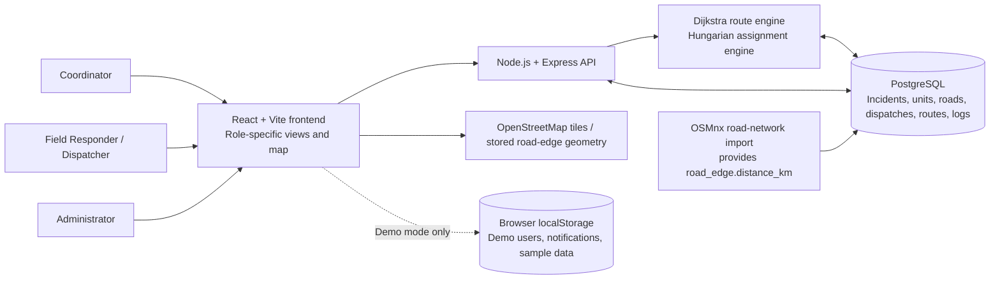
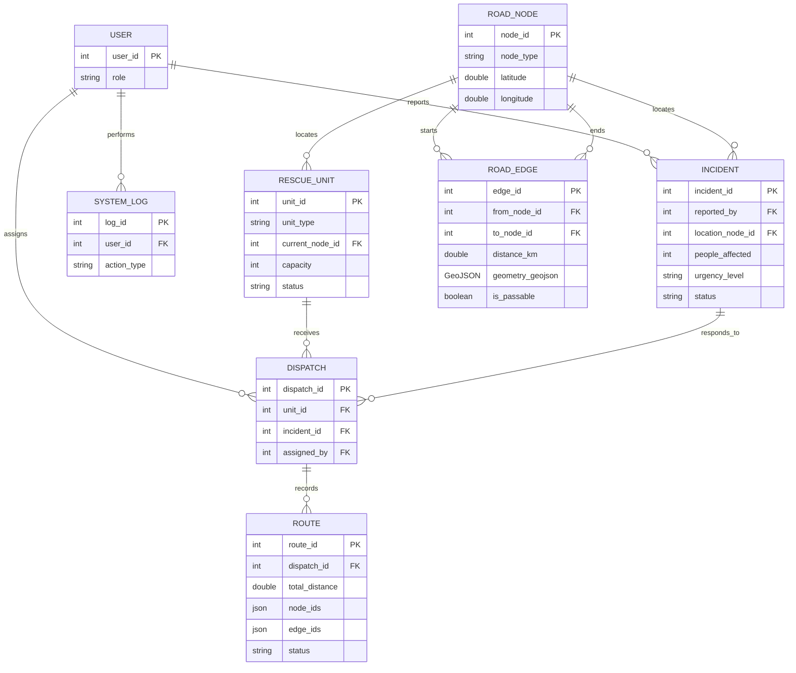

# Current System Diagrams

These diagrams describe the implementation after the route-weight and active-route changes. They are editable Mermaid sources for updating the thesis figures; they do not modify the attached PDFs.

## System Architecture

The optimizer runs inside the Node backend in this repository; there is no separate Python/Flask service. Demo authentication, role switching, notifications, and sample data use browser storage. Production authentication, account administration, and an email/SMS notification gateway are not implemented by this prototype.

## Entity-Relationship Diagram

`unit_type`, `distance_km`, route path arrays, and route status are added by `backend/migrations/002_weighted_edges_and_route_paths.sql`; `people_affected` is added by migration 001; `barangay`, `location_latitude`, and `location_longitude` are added by migration 003; and `geometry_geojson` is added by migration 004. Incident coordinates identify the approximate barangay point, while `location_node_id` remains the road-network endpoint used by route calculations. The road-data import must populate positive `road_edge.distance_km` values and directed GeoJSON LineStrings that match each edge's endpoint nodes. The original thesis ERD should show these fields. The `USER` entity shown here still reflects the limited database contract; full name, email, password hash, and active-account management need a separate production authentication/account schema and API.

## Map route semantics

In database mode, assigned-route maps compute a shortest passable graph path for the orange recommended route, a distinct strictly longer passable graph path for blue, and a connected path containing a marked impassable edge for red dashed. Red geometry is split around portions that overlap the orange route so the two classifications are not drawn on top of each other; orange remains rendered above blue and red. Routes use positive imported `distance_km` values and per-edge `geometry_geojson` LineStrings validated against directed road nodes; missing or invalid values are not replaced with guessed paths.

In demo mode, the three seeded assignments use explicit route fixtures so each presentation map has a shortest passable route, a longer passable alternative, and a simulated blocked route to the same incident. The shortest fixture is also used for dispatch distance calculations. Route distances and via points are based on OSRM road routes; passability and blocked status are simulated presentation data, not verified conditions. The browser fetches street-following geometry and only draws routes that reach both unit and incident markers; it does not add straight connectors. Overlapping red geometry is hidden only where it follows the orange route. Other assignments continue to use the sample graph and omit unavailable alternatives. The demo intake is restricted to 10 nearby barangays: Guinhawa, Catmon, Bulihan, Mojon, San Vicente (Poblacion), Tikay, Dakila, Atlag, Bangkal, and Santo Rosario (Poblacion); other barangays are disabled. Overview and dispatch maps compute routes for the selected active assignment, and dispatch recommendations use passable paths only.
