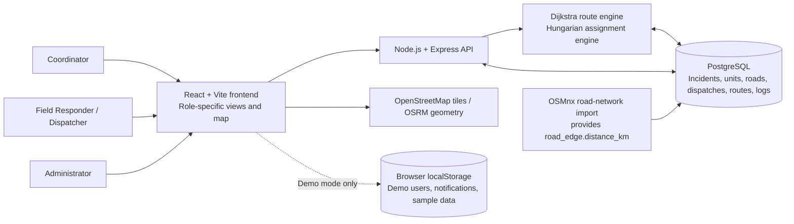
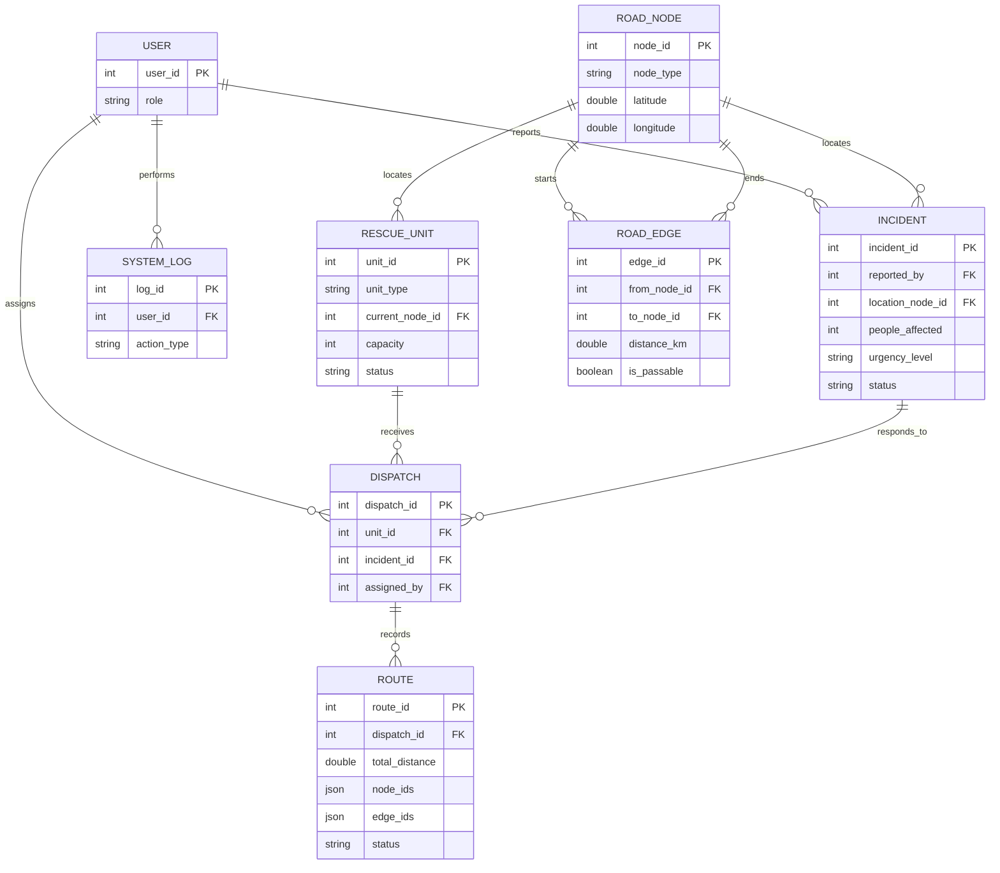

# Current System Diagrams

These diagrams describe the implementation after the route-weight and active-route changes. They are editable Mermaid sources for updating the thesis figures; they do not modify the attached PDFs.

## System Architecture

The optimizer runs inside the Node backend in this repository; there is no separate Python/Flask service. Demo authentication, role switching, notifications, and sample data use browser storage. Production authentication, account administration, and an email/SMS notification gateway are not implemented by this prototype.

## Entity-Relationship Diagram

`unit_type`, `distance_km`, route path arrays, and route status are added by `backend/migrations/002_weighted_edges_and_route_paths.sql`; `people_affected` is added by migration 001. The OSMnx import must populate `road_edge.distance_km` before database-backed optimization is enabled. The original thesis ERD should show these fields. The `USER` entity shown here still reflects the limited database contract; full name, email, password hash, and active-account management need a separate production authentication/account schema and API.

## Map route semantics

Road passability describes an individual edge, while assigned-route maps compare Point A-to-Point B route options for the selected active assignment. The orange recommended route is the shortest passable path; the blue passable route is a longer alternative; and a red dashed blocked route connects Point A to Point B through an impassable edge to show the route that cannot be taken. The blocked route is computed as a passable approach, exactly one closed edge, and a passable continuation to the incident; repeated nodes and dead-end branches are excluded. Each complete route is rendered as one road-following geometry through its ordered network-node waypoints, avoiding gaps and misleading dead-end branches from independently snapped per-edge geometry. The red dashed route is explanatory only and is never treated as traversable. All available route types are displayed together, with the recommended route layered above passable alternatives and blocked routes. Overview and dispatch maps select from active assignments; pending and resolved incidents are excluded. Dispatch recommendations continue to use passable edges only.
